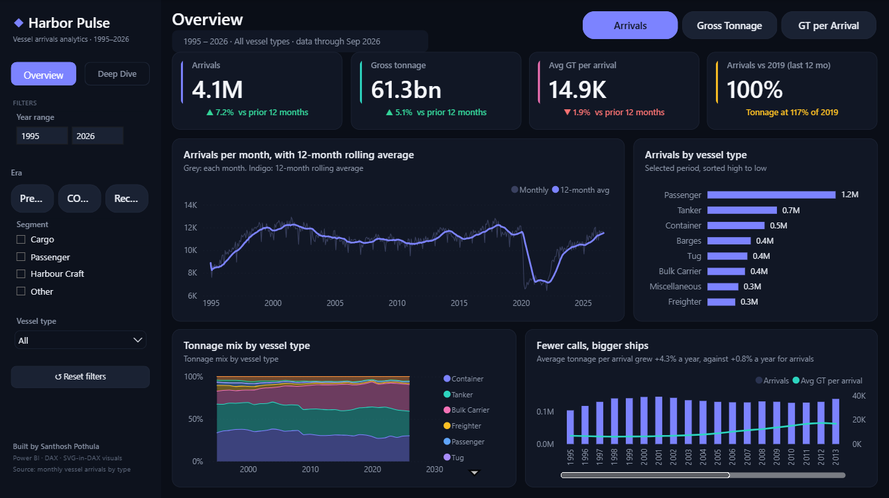
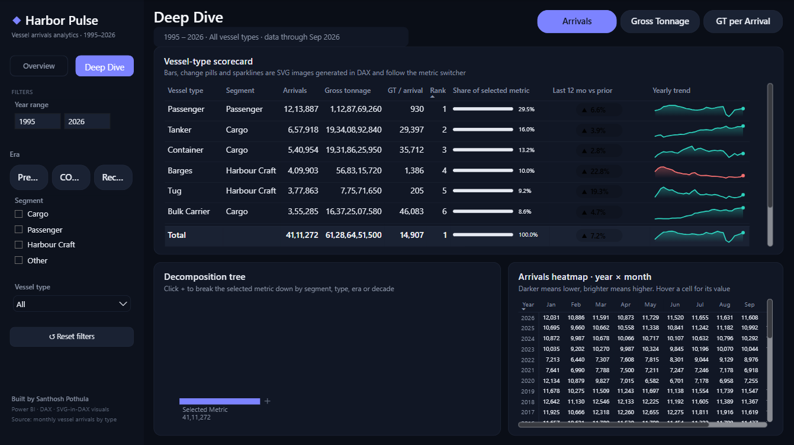

# ◆ Harbor Pulse: Power BI dashboard

A two-page Power BI dashboard on 30 years of monthly vessel arrivals and gross tonnage (1995 to 2026), by vessel type.

**▶ Showcase page:** https://santhoshp24.github.io/harbor-pulse-powerbi/



## Highlights
- **Story:** average tonnage per arrival grew 4.3% a year, while arrival counts grew just 0.8% a year. Ports are handling fewer, bigger ships.
- **Model:** star schema in TMDL (Arrivals fact table, Calendar, Vessel Type, and a disconnected Metric table for the metric switcher).
- **DAX:** 44 measures, including trailing-12-month change, a recovery index against 2019, CAGR over complete years, a rolling average, rank and share, and dynamic titles.
- **SVG-in-DAX:** sparklines, share bars and change pills drawn as SVG images by measures and shown in a native table.
- **Design:** custom dark theme, slicers synced across both pages, page navigation, and a reset button.
- **Data source:** Power Query reads the CSV from this repo with `Web.Contents`, so the model refreshes without a gateway.



## Open it
1. Clone the repo and open `HarborPulse.pbip` in Power BI Desktop (a recent version with PBIR support).
2. Click **Refresh**. When asked how to connect to the GitHub URL, choose **Anonymous**.

## Structure
```
HarborPulse.pbip                  Power BI project file
HarborPulse.SemanticModel/        TMDL model (tables, measures, relationships)
HarborPulse.Report/               PBIR report (pages, visuals, custom theme)
data/vessel_arrivals_monthly.csv  Source data
docs/                             GitHub Pages showcase site
```

Built by Santhosh Pothula.
